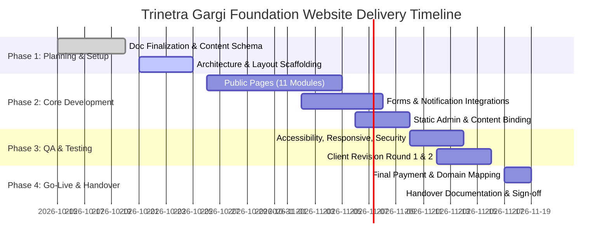

**Purpose:** Master project overview, contractual baseline, deliverables directory, and documentation index.
**Status:** Active
**Last updated:** 2026-10-15

# Trinetra Gargi Foundation — Official Website Project

Comprehensive technical documentation and operational baseline for the official website development of **Trinetra Gargi Foundation**, executed by **Win Edge Solutions**.

---

## 1. Project Overview & Fact Sheet

| Parameter | Project Specification | Reference / Source |
|---|---|---|
| **Client** | Trinetra Gargi Foundation (Multi-domain NGO: Education, Child Protection & Labour Prevention, Women & Community Empowerment, Family Support, Skill Development, Health & Digital Literacy) | Project Contract |
| **Vendor** | Win Edge Solutions | Quotation **TGF-2026-003** |
| **Lead / Author** | Likhit Verma, Chief Operating Officer (COO) | Win Edge Solutions |
| **Project Nature** | Website engineering and design execution only (Content, media, and legal reports supplied ready-to-publish by Foundation) | Fixed-scope contract |
| **Total Price** | **INR 30,000** | Quotation TGF-2026-003 |
| **Payment Schedule** | Milestone 1: **INR 15,000** (Advance before kickoff) Milestone 2: **INR 15,000** (Pre-handover & Go-Live clearance) | Signed Commercial Terms |
| **Project Start** | **15 October 2026** | Project Schedule |
| **Handover Window** | **15 November 2026 – 20 November 2026** | Delivery Target |
| **Core Architecture** | Next.js (App Router), TypeScript, Tailwind CSS, react-hook-form + zod | [`docs/ARCHITECTURE.md`](docs/ARCHITECTURE.md) |
| **Content Strategy** | File-based typed models under `/content` (No external database dependency for Phase 1) | [`docs/CONTENT-MODEL.md`](docs/CONTENT-MODEL.md) |
| **Design Reference** | `/design/warm_radiant_social_trust/DESIGN.md` + 7 screen mockups | [`docs/DESIGN-SYSTEM.md`](docs/DESIGN-SYSTEM.md) |

---

## 2. Project Timeline & Delivery Phases

---

## 3. Included Deliverables (11 Core Sections)

The project includes the design, responsive implementation, and content-binding for the following 11 core sections:

1. **Home Portal:** Mission statement, key impact numbers, urgent Help/Report button, latest news/stories showcase, and primary Donate call-to-action.
2. **About Us:** Vision, mission, statutory objectives, founder message, leadership team, and organizational journey.
3. **Our Work:** 6 distinct intervention pillars (Education, Child Protection, Women Empowerment, Family Support, Skill Development, Health & Digital Literacy).
4. **Government Schemes:** Curated directory of up to 10 verified welfare schemes with category filter, search, and official government portal links.
5. **Awareness & Resources:** Thematic awareness modules, downloadable public advocacy posters, and policy brochures (PDF).
6. **Help & Report (SOS):** Confidential intake form with optional anonymity, whistleblower notice, emergency guidance, and zero file attachment exposure.
7. **Impact & Reports:** Verified metric disclosures, annual/financial reports, and governance/registration compliance documentation.
8. **Donations:** Dedicated tax-relief donation portal featuring UPI QR, direct NEFT/RTGS bank details, and third-party gateway links.
9. **News, Events & Stories:** Real-world ground news, community assembly announcements, event imagery, and success case studies.
10. **Volunteer & Partner:** Dual intake channels for individual grassroots volunteers and institutional/corporate CSR partnerships.
11. **Contact & FAQ:** Categorized enquiry form, office address, map location card, and common operational FAQs.

**Supporting Features Included:** Mobile-responsive interface (360px–1536px), basic admin panel (news, events, stories, schemes, impact figures), email alert hooks, PDF downloads, photo gallery grid, SEO meta configuration, social links + floating WhatsApp button, anti-spam honeypot security, and legal pages (Privacy Policy, Terms of Service, Disclaimer, Custom 404).

---

## 4. Scope Guard & Explicit Exclusions

To prevent scope creep and ensure timely delivery, the following elements are strictly **NOT included**:
- Copywriting, content creation, translation, or independent verification of submitted data.
- User file or media attachments on the Help & Report intake form.
- Interactive district mapping or dedicated sub-pages for individual districts.
- Individual child/education sponsorship tracking platforms.
- Public campaign fundraising progress bars or real-time ticker engines.
- Global site-wide search or full-text resource indexers (only Scheme filter is allowed).
- Dynamic financial visualizer dashboards or graphical donation breakdown charts.
- Standalone landing pages for individual staff profiles or separate school outreach portals.
- AI chatbots, live customer support agents, or automated chat popups.
- Language toggle switches or multilingual mirror pages (site is 100% English).
- Email newsletter marketing subscription engines.
- Any feature or design alterations requested after final handover sign-off.

---

## 5. Owner-Paid Financial Boundaries

All third-party recurring fees and external cloud services are paid directly by the client (**Trinetra Gargi Foundation**):
- Domain registration and annual DNS renewal.
- Production hosting, cloud computing, and server infrastructure.
- Database services, cloud object storage, and backup retention vaults.
- Transactional email dispatch services (e.g., Resend, SendGrid) and SMS gateways.
- Dedicated SSL certificates (if requiring enterprise-level SAN/EV).
- Payment gateway merchant account onboarding and transaction deduction fees.

---

## 6. Handover & Post-Launch Support Terms

- **Pre-Handover Revisions:** Up to **2 revision rounds** included. Each round consists of one consolidated written punch list submitted by the client within 3 working days.
  - **Defect / Fix:** Rectification of any feature not functioning as agreed (included at INR 0).
  - **Scope Change:** Any addition or variation from the agreed 11 sections (billed separately).
- **Post-Handover Warranty (First 30 Days):** Free operational support covering defect rectifications and up to 5 minor text/image updates to Foundation-provided content.
- **Subsequent Maintenance (Optional):** Annual retainer available at **INR 6,000/year**.
- **Out-of-Scope Rate Card:**
  - Minor text/graphic edit: INR 300
  - Additional page template: INR 1,500
  - Additional custom form: INR 2,000
  - General developer engineering: INR 600 / hour
  - Custom module quotation: From INR 3,000
  - Urgent turn-around surcharge (< 24 hours): +50%

---

## 7. Master Documentation Index

| Documentation File | Target Purpose |
|---|---|
| [`AGENTS.md`](AGENTS.md) | Contributor scope boundaries, coding rules, and constraints |
| [`docs/PRD.md`](docs/PRD.md) | Detailed Product Requirements Document & Acceptance Criteria |
| [`docs/SITEMAP-AND-FLOW.md`](docs/SITEMAP-AND-FLOW.md) | Information architecture, routing, and user journey flowcharts |
| [`docs/DESIGN-SYSTEM.md`](docs/DESIGN-SYSTEM.md) | Design tokens, typography, component states, and AA contrast |
| [`docs/DESIGN-VS-SCOPE.md`](docs/DESIGN-VS-SCOPE.md) | Stitch screen audit: Keep, Cut, and Placeholder decisions |
| [`docs/CONTENT-MODEL.md`](docs/CONTENT-MODEL.md) | TypeScript content data contracts and placeholder schema |
| [`docs/CONTENT-CHECKLIST.md`](docs/CONTENT-CHECKLIST.md) | Client content deliverables tracking matrix |
| [`docs/FORMS-SPEC.md`](docs/FORMS-SPEC.md) | Form field schemas, validation, rate limits, and security |
| [`docs/SAFEGUARDING-AND-LEGAL.md`](docs/SAFEGUARDING-AND-LEGAL.md) | Minor protection, helpline checks, and tax claim gates |
| [`docs/ARCHITECTURE.md`](docs/ARCHITECTURE.md) | Technical architecture, App Router layout, and services |
| [`docs/QA-CHECKLIST.md`](docs/QA-CHECKLIST.md) | Comprehensive quality assurance and browser test matrix |
| [`docs/TASKS.md`](docs/TASKS.md) | Phased project work breakdown and status checkboxes |
| [`docs/DECISIONS.md`](docs/DECISIONS.md) | Architectural and commercial decision log |
| [`docs/CHANGE-LOG.md`](docs/CHANGE-LOG.md) | Formal record of revision rounds and billable variations |
| [`docs/DEPLOYMENT-AND-HANDOVER.md`](docs/DEPLOYMENT-AND-HANDOVER.md) | Go-live verification, credential transfers, and sign-off |
| [`docs/pages/`](docs/pages/) | Individual specifications for all 12 page routes |
| [`.agent/workflows/`](.agent/workflows/) | Step-by-step developer workflows for pages, forms, and QA |
