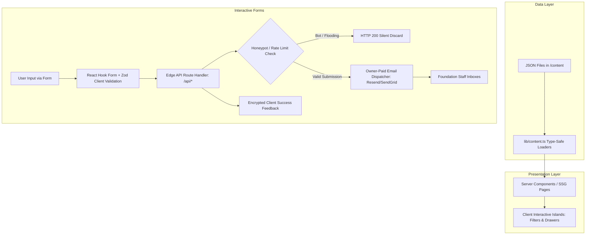

**Purpose:** Technical architecture specification covering Next.js App Router layout, data flow, environment variables, owner-paid cloud service mapping, admin architecture, and deployment model.
**Status:** Active
**Last updated:** 2026-10-15

# System Architecture & Technical Specifications

---

## 1. Project Directory Structure (Next.js App Router)

```
trinetra-gargi-foundation/
├── .agent/                       # Developer & AI operational workflows
│   └── workflows/                # Standardized step-by-step procedures
├── app/                          # Next.js App Router tree
│   ├── (public)/                 # Public user-facing routes
│   │   ├── page.tsx              # Section 1: Home Portal
│   │   ├── about/page.tsx        # Section 2: About Us
│   │   ├── our-work/page.tsx     # Section 3: Our Work
│   │   ├── government-schemes/   # Section 4: Government Schemes
│   │   │   └── page.tsx
│   │   ├── awareness/page.tsx    # Section 5: Awareness & Resources
│   │   ├── help-report/page.tsx  # Section 6: Help & Report (SOS)
│   │   ├── impact/page.tsx       # Section 7: Impact & Reports
│   │   ├── donate/page.tsx       # Section 8: Donations
│   │   ├── stories-events/       # Section 9: News, Events & Stories
│   │   │   └── page.tsx
│   │   ├── volunteer-partner/    # Section 10: Volunteer & Partner
│   │   │   └── page.tsx
│   │   ├── contact-faq/page.tsx  # Section 11: Contact & FAQ
│   │   ├── privacy/page.tsx      # Privacy Policy
│   │   ├── terms/page.tsx        # Terms of Service
│   │   ├── disclaimer/page.tsx   # Statutory Disclaimer
│   │   └── not-found.tsx         # Custom 404 Error Page
│   ├── admin/                    # Static Content Admin Interface
│   │   └── page.tsx
│   ├── api/                      # Edge / Node Route Handlers
│   │   ├── help-report/route.ts  # Triage email dispatch
│   │   ├── volunteer/route.ts    # Volunteer application email dispatch
│   │   ├── partnership/route.ts  # CSR inquiry email dispatch
│   │   ├── contact/route.ts      # General inquiry email dispatch
│   │   └── donation-receipt/     # 80G receipt request email dispatch
│   │       └── route.ts
│   ├── layout.tsx                # Master root layout (Nav, Ribbons, Footer)
│   ├── globals.css               # Design system tokens and Tailwind base
│   ├── robots.ts                 # Dynamic robots.txt
│   └── sitemap.ts                # Dynamic sitemap.xml
├── components/                   # Reusable UI component library
│   ├── shared/                   # Header, TopRibbon, Footer, QuickExit
│   ├── ui/                       # Buttons, inputs, modals, tooltips, cards
│   ├── forms/                    # Zod-backed form components
│   └── icons/                    # Material Symbols & custom SVGs
├── content/                      # Strongly typed file-based JSON data
│   ├── site.json                 # Foundation config, statutory data, helplines
│   ├── schemes.json              # Up to 10 verified government schemes
│   ├── stats.json                # Impact metrics and counter definitions
│   ├── stories.json              # Ground case studies and field stories
│   ├── events.json               # Community conclaves and camps
│   ├── reports.json              # Statutory filings and audit documents
│   ├── team.json                 # Leadership and advisory members
│   └── faqs.json                 # Operational and reporting FAQs
├── docs/                         # Master project documentation
├── lib/                          # Utility functions and shared helpers
│   ├── content.ts                # Strongly typed JSON loaders
│   ├── email.ts                  # Transactional email dispatcher client
│   └── validations/              # Zod validation schemas
├── public/                       # Static public assets
│   ├── documents/                # Downloadable statutory and awareness PDFs
│   ├── images/                   # High-res logos, banner graphics, portraits
│   └── favicon.ico               # Brand favicons
├── tailwind.config.ts            # Design system token definitions
├── tsconfig.json                 # Strict TypeScript configuration
└── package.json                  # Next.js, React, RHF, Zod dependencies
```

---

## 2. Data Flow Architecture



1. **Zero Database Overhead:** High-traffic informational pages (Home, About, Our Work, Schemes) are compiled statically (SSG) at build time, yielding near-instant page loads and zero database hosting costs.
2. **Real-Time Client Filtering:** The Government Schemes Directory renders all records statically, enabling instant client-side searching and category filtering without network latency.
3. **Secure Form Pipeline:** Forms submit JSON payloads to server route handlers (`/api/*`), which enforce honeypot checks, evaluate IP rate limits, sanitize inputs, and invoke the owner-paid email dispatch API.

---

## 3. Environment Variables Specification

The application requires only four clean environment variables:

| Variable Name | Required | Exposure | Description / Purpose |
|---|:---:|:---:|---|
| `NEXT_PUBLIC_SITE_URL` | Yes | Client & Server | Canonical public domain e.g. `https://trinetragargifoundation.org` |
| `EMAIL_SERVER_API_KEY` | Yes | Server Only | API key for transactional email dispatcher (Resend, SendGrid) |
| `NOTIFICATION_RECEIVER_EMAIL`| Yes | Server Only | Primary recipient address for form notifications |
| `NEXT_PUBLIC_PAYMENT_GATEWAY_KEY`| No | Client & Server | Public merchant key if gateway checkout is enabled |

---

## 4. Owner-Paid Third-Party Services Mapping

All external operational services are provisioned and directly funded by the client (**Trinetra Gargi Foundation**):

| Service Category | Recommended Provider | Mapped Feature | Responsibility Boundary |
|---|---|---|---|
| **Domain & DNS** | Cloudflare / GoDaddy / Namecheap | Public website address & SSL termination | Foundation pays renewal fees; Vendor configures DNS records |
| **Production Hosting**| Vercel / Cloudflare Pages / AWS | Next.js compute, edge CDN, and asset delivery | Foundation holds account; Vendor deploys code |
| **Transactional Email**| Resend / SendGrid / AWS SES | Form alerts for Help/Report, Volunteer, CSR, Contact | Foundation provides API keys; Vendor writes integration logic |
| **Payment Gateway** | Razorpay / Cashfree Payments | Online donations via Net Banking / Cards | Foundation manages KYC merchant onboarding; Vendor configures link |
| **File Storage** | Public repo assets / Cloudflare R2 | PDF reports and awareness brochures | Local static assets in repo (no storage cost in Phase 1) |

---

## 5. Static Admin Panel Architecture (`/admin`)

- **Lightweight Access:** A standalone, responsive admin dashboard accessible at `/admin`.
- **Zero Backend Maintenance:** Reads current schemas from `/content/*.json` directly into editable browser forms.
- **Form-Based Editing:** Enables non-technical Foundation staff to update scheme entries, add news items, revise impact numbers, and manage story texts.
- **Export Workflow:** Staff can download validated, updated JSON files to replace local assets, or trigger an automated GitHub repository commit using an authorized Personal Access Token.
- **Security:** In Phase 1, the admin interface is protected via HTTP Basic Authentication or client-side secret passphrase stored in session storage.

---

## 6. Deployment Model

- **Target Deployment:** Production Vercel or Node.js Standalone container.
- **Build Command:** `next build`
- **Output:** Statically generated HTML/JSON assets backed by serverless edge functions for `/api/*` route handlers.
- **Cache Invalidation:** Incremental Static Regeneration (ISR) or on-demand revalidation on git push.
