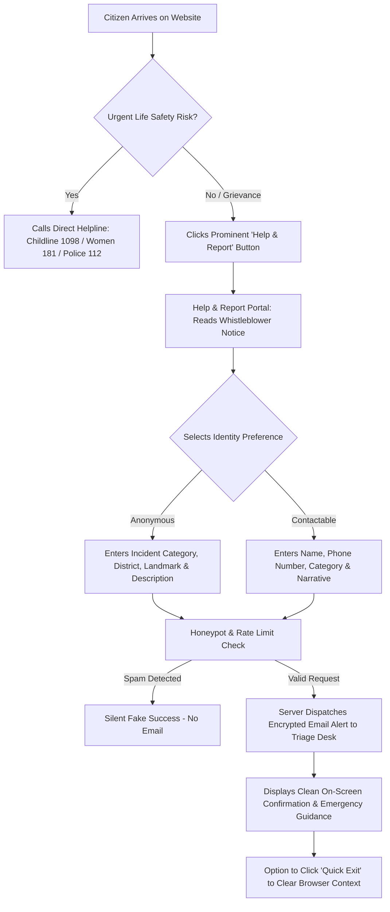
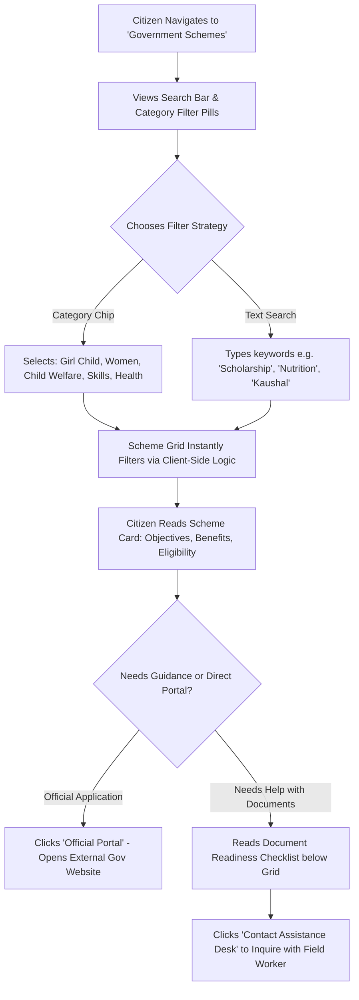
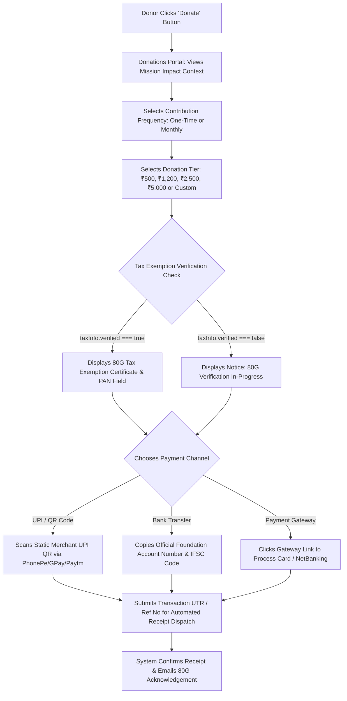
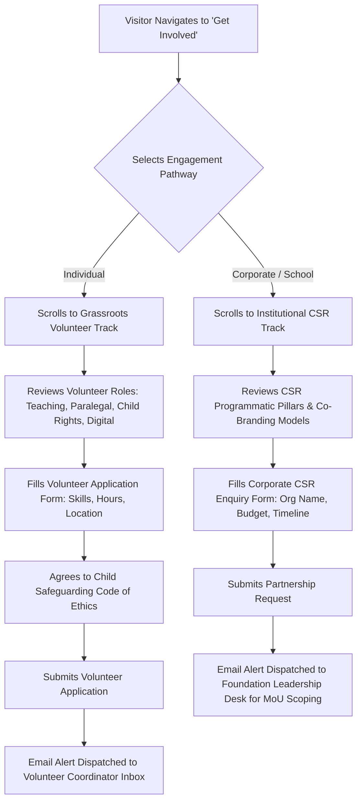

**Purpose:** Definition of information architecture, routing hierarchy, single global navigation structure, and Mermaid user journey flowcharts.
**Status:** Active
**Last updated:** 2026-10-15

# Sitemap and User Flow Specification

---

## 1. Information Architecture & Master Route Directory

| Route Path | Page Title | Navigation Label | Hierarchy Level | Primary User Action |
|---|---|---|:---:|---|
| `/` | Home Portal | Home | Primary | Discover mission, view stats, access SOS reporting, explore 6 pillars |
| `/about` | About Us | About | Primary | Review vision, founder message, milestones, and statutory governance |
| `/our-work` | Our Work (6 Pillars) | Our Work | Primary | Examine 6 thematic pillars, lifecycle model, and KPIs |
| `/government-schemes` | Government Welfare Schemes | Schemes | Primary | Filter and search verified welfare schemes with official application links |
| `/awareness` | Community Awareness & Resources | Awareness | Primary | Read rights guides and download public awareness PDF posters/brochures |
| `/impact` | Impact Metrics & Audited Reports | Impact | Primary | Review verified metric counters and download annual activity & audit reports |
| `/stories-events` | Ground News, Events & Stories | News & Events | Primary | Read transformation case studies and review community assemblies |
| `/volunteer-partner` | Volunteer & Institutional Partnerships | Get Involved | Primary | Submit grassroots volunteer application or initiate corporate CSR partnership |
| `/donate` | Support Our Mission (Donations) | Donate | Primary (Accent) | Contribute via UPI QR, bank NEFT/RTGS, or payment gateway |
| `/help-report` | Emergency Crisis & Grievance Report | Help & Report | Primary (Emergency SOS) | Submit confidential or anonymous distress alert; access toll-free hotlines |
| `/contact-faq` | Contact Us & Operational FAQ | Contact & FAQ | Utility / Secondary | Submit general inquiry, view registered office address, read FAQs |
| `/privacy` | Privacy Policy | Privacy Policy | Footer / Legal | Review data retention, anonymity rules, and whistleblower protection |
| `/terms` | Terms of Service | Terms of Service | Footer / Legal | Understand terms of website use and non-profit disclaimer |
| `/disclaimer` | Statutory & Emergency Disclaimer | Disclaimer | Footer / Legal | Note on helpline verification and statutory regulatory status |
| `/admin` | Static Content Admin Dashboard | Admin | Utility (Staff) | View, modify, and export static content schemas |
| `/404` | Page Not Found | 404 Error | Error Page | Recover navigation back to Home Portal |

---

## 2. Global Navigation Architecture

To maintain clarity and prevent navigation clutter, the website features **ONE unified global navigation bar** deployed consistently across all 11 pages.

### Navigation Layout
```
[Logo: Trinetra Gargi Foundation]
  ├── Nav Link 1: Home
  ├── Nav Link 2: About
  ├── Nav Link 3: Our Work
  ├── Nav Link 4: Schemes
  ├── Nav Link 5: Awareness
  ├── Nav Link 6: Impact
  ├── Nav Link 7: News & Events
  ├── Nav Link 8: Get Involved
  ├── Accent CTA: Donate (Gold/Amber Button)
  └── Emergency Action: Help & Report (Crimson SOS Badge - Always Visible)
```

- **Top Emergency & Trust Ribbon:** Fixed above the navbar on all screens, displaying:
  - 24/7 Response Active indicator
  - Childline 1098 (Toll-Free)
  - Women Helpline 181
  - Sec 80G Certified • CIN: `U85300RJ2026NPL098757` (Gated)
  - Quick Safety Exit button (instant redirect to Google)
- **Mobile Responsive Drawer:** On screens < 1024px, the navigation collapses into an off-canvas slide-out drawer preserving the exact link order, contact hotlines, and quick exit shortcut.

---

## 3. Core User Journey Flowcharts

### Journey 1: Report a Concern (Help & Report SOS)


---

### Journey 2: Find a Government Scheme


---

### Journey 3: Make a Donation


---

### Journey 4: Volunteer or Partner (Get Involved)

